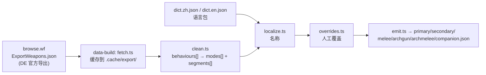

# 本地武器 / Mod 数据来源，与 `@wfcd/items` 的比对（2026-11-06）

> 结论先行：**`@wfcd/items` 不能单独满足本项目的伤害计算需要。**
> 它的武器数据把官方 `behaviours[]` 的**四类伤害段压平**成一个 `attacks[]`、丢掉**段级触发率**，
> 并且对同一份官方导出做了**合并与命名加工**（实测有污染）；Mod/赋能/套装全是**文本**，
> 与本地「逐级数值 + 乘区 + 条件 + 互斥」的结构完全不同。
>
> 但它有两个**现成的补缺**价值：
> 1. **AoE 距离衰减**（`falloff{start,end,reduction}`）——本地 126 把带 AoE 的武器里 123 把有值，
>    正好补 `data-todo` 第 1 节；
> 2. **多模式 / 灵化模式的面板数值**（暴率 / 暴伤 / 触发 / 射速）——补 `data-todo` 第 2 节。
>
> 是否引入见 [`docs/decisions.md`](../docs/decisions.md) 的 **D-069（待确认）**，本文不替需求方拍板。

验证环境：Windows / Node v24.10.0 / `@wfcd/items` **1.1276.47**（npm 发布时间 2026-11-01，MIT）。
本机 GitHub 域名被 TLS 中间人拦截，改从 npmmirror 取 tarball 解包比对；
本地官方导出用的是仓库缓存 `.cache/export/weapons.json`（2026-11-04 抓取）。

---

## 1. 本地武器与 Mod 数据到底来自哪

### 1.1 武器（`packages/data/src/generated/weapons/`）



| 产出字段 | 来源 | 加工 |
|---|---|---|
| `critChance` / `critMultiplier` / `statusChance` / `fireRate` | 导出顶层同名字段 | `tidy()` 保留 4 位小数 |
| `magazineSize` / `reloadTime` | 导出顶层 | 同上 |
| `modes[].segments[]` | 导出 **`behaviours[]`** 的 `impact` / `projectile.attack` / `projectile.explosiveAttack`（蓄力时读 `chargedProjectile`）<br>**`projectile.embedDeathAttack` 不收录**（D-078：它是碎尸比例，总额恒 100，与伤害无关） | 段级过滤占位符（等值物理三元素 / 单元素小额，D-079）；`procChance` **逐段保留** |
| `modes[].multishot` | 导出**顶层** `multishot`（`behaviours[].fireIterations` 只进 `bullets` 做溯源） | D-009 |
| `modes[].trigger` | `behaviours[].stateName` 语言键的尾段 | `stateName` 缺失 → `unknown`（A-13） |
| `modes[].burst` | `behaviours[].burst` | |
| `name` / `nameZh` | 语言包 `dict.en/zh.json`，键 = 导出的 `name` 语言键 | |
| `fireRate`（个别） | **人工** `manual/overrides.ts`（目前只有 `Railgun`，导出射速为 0） | 带 `_manual` |

**注意**：`data-todo/README.md` 说的"官方导出不给 AoE 半径/衰减"是对的——导出里只有近战的
`slamRadius` / `heavySlamRadius`，`explosiveAttack` 只有伤害与 `procChance`。

### 1.2 Mod / 赋能 / 套装（`packages/data/src/generated/mods/`）

| 产出 | 数值来自 | 结构（乘区/条件/互斥）来自 |
|---|---|---|
| `mods.json`（442） | **需求方的紫卡模拟器 HTML `20261031紫卡模拟器V10.html` 里的 `ZKMODS`**（满级值 + 等级上限） | **本项目自己的 `stat-map.ts` 人工映射** + 官方 `ExportUpgrades.json` 的 `compat` / `polarity` / `baseDrain` |
| `arcanes.json`（56） | 官方 **`ExportArcanes.json`**（结构化逐级数值槽，藏在多语言模板里） | 本项目人工标注 `effectKind` / `bucket` |
| `mod-sets.json`（19） | 官方 **`ExportModSet.json`** | 本项目人工标注 `SET_EFFECTS` |
| `weapon-slots.json`（842） | ZK 武器库 `c` 字段 → 官方 `holsterCategory` → `*_STANCE` 标签 → 产品大类 → `exalted-slots.ts` | 本项目判定逻辑 D-001 |

**关键结论**：本地的 Mod 层是「**一份外部数值表 + 本项目的人工结构映射**」，
`@wfcd/items` 里既没有那份 `ZKMODS`，也没有任何"乘区归属"。所以这一层**不存在"替换成 WFCD"的选项**，
只有"拿 WFCD 校验名字/极性/等级上限"这一个用途。

---

## 2. `@wfcd/items` 是什么

- 包名 `@wfcd/items`，MIT，最新 `1.1276.47`，unpacked 约 **90 MB**（含 14 种语言包）。
- 产物是 `data/json/*.json`：`Primary`(197) / `Secondary`(149) / `Melee`(270) / `Arch-Gun`(20) /
  `Arch-Melee`(8) / `SentinelWeapons`(24) / `Mods`(1809) / `Arcanes`(172) / `i18n/*.json`。
- **不是**官方导出的朴素转储：`attacks[]` 是 WFCD 自己从官方 behaviours + Wiki 文献**派生**的。
  证据见第 3 节。

字段对照（武器）：

| 本地字段 | WFCD 对应 | 说明 |
|---|---|---|
| `id`（导出键最后一段） | `uniqueName` 最后一段 | **可 1:1 对上**（637 → 608） |
| `name` / `nameZh` | `name` + `i18n/zh.json` | 中文包在包里，不需要再抓 browse.wf |
| `category` | `category` / `productCategory` | 一致 |
| `critChance` … `reloadTime` | `criticalChance` … `reloadTime` | **一致**（实测无差异，见 3.4） |
| `modes[].segments[]` | `attacks[]` | **结构不同，见 3.1/3.2** |
| `modes[].multishot` | `multishot` | 一致（442/442 无差异） |
| `modes[].segments[].procChance` | `attacks[].status_chance`（模式级） | **段级丢失** |
| — | `attacks[].shot_type` | `Hit-Scan` / `Projectile` / `AoE` / `DoT` / `Thrown` |
| — | `attacks[].falloff` | **本地没有**，可补 AoE 衰减 |
| — | `attacks[].charge_time` | 本地没有（蓄力时间） |
| `variantType`（`VT_KUVA` 等） | **无** | 玄骸/变体判定用不了 |
| `compatibilityTags`（`ASSAULT_AMMO`…） | **无**（只有 `tags:["Grineer","Kuva Lich"]`） | 可装 Mod 判定用不了 |

---

## 3. 逐项实测比对

样本：本地 637 把武器 × WFCD 6 类武器 json，按 `uniqueName` 末段 join。

### 3.1 结构：四类伤害段被压平

官方 Kuva Ogris 的一个 behaviour：

```
projectile: {
  attack:          { DT_IMPACT 18.9, DT_PUNCTURE 8.1, procChance 0.47 }
  explosiveAttack: { DT_PUNCTURE 183, DT_SLASH 155, DT_EXPLOSION 349, procChance 0.47 }
  embedDeathAttack:{ DT_EXPLOSION 500 }        ← 没有 procChance
}
impact:            { DT_IMPACT 10, procChance 0.35 }
```

WFCD 只有两条：

```
Rocket Impact    shot_type=Projectile  {impact 18.9, puncture 8.1}        ← 少了 impact 段的 10
Rocket Explosion shot_type=AoE         {slash 155, puncture 183, blast 349} ← embedDeath 的 500 被并进来
```

后果（都对应本项目已确认的口径）：

| 本项目口径 | 依赖的段结构 | 压平后 |
|---|---|---|
| D-009 / 第 2.2 节：多重只看面板、实弹不重复乘多重 | `impact` 与 `attack` 分开 | 合不回来 |
| 第 2.1 节 / C-01：AoE 基伤不吃镀层类 | `explosiveAttack` 单独一段 | 只剩 `shot_type` 标签，阈值一走就丢 |
| DoT 基础值 = 各段命中伤之和（第 6.2 节） | 段级 `procChance` + 各段伤害 | 段级触发率全丢 |

### 3.2 加工污染（同一份官方导出，WFCD 派生出不同语义）

| 武器 | 官方 behaviours | WFCD attacks | 判断 |
|---|---|---|---|
| `HeavyRifle`（Gorgon） | 第二段**无 `stateName`**，`projectile.attack` 20/60/20 + `embedDeathAttack DT_FIRE 725` | 命名为 `Incarnon Form`（impact 20/slash 20/puncture 60）+ `Incarnon Form AoE`（heat **750**） | 把"无名 behaviour"当成灵化形态，并把 725 改写成 750 |
| `Kuva Ogris` | 见 3.1 | impact 段被减掉 10 | 数值被改写 |
| `Rifle`、`BratonPrime`、`Boltor`、`Gorgon`… | `embedDeathAttack` / 第二 behaviour | `attacks[]` 里出现 `Incarnon Form` | 灵化判定是本项目的 `isIncarnonBehaviour()` 规则（见 `clean.ts`），与 WFCD 的命名**不保证一致** |

### 3.3 覆盖率

| 项 | 结果 |
|---|---|
| 武器 join 成功 | 608 / 637 |
| join 失败 | **29 把，全是显赫武器**：`ExaltedBook`、`ExaltedSniper`、`GarudaClaws`、`MonkeyKingStaff`、`KhoraWhipclawWeapon`、`NechroTechSwordWeapon`… |
| 近战三连击（`axis` 字段） | **0 / 220 把有**（官方 behaviours 里也没有） |
| 模式数恰好相等 | 242 / 608（其余 366 把 WFCD 段数更多——因为 AoE 被拆成独立 attack） |
| 伤害类型集合一致 | 339 / 608（其余 269 把差异来自 3.1 的段被丢/被并） |

> 29 把显赫武器缺席很关键：**D-018 的标杆武器里，Braton / Boltor 的灵化形态正是这类"第二 behaviour"**，
> 而显赫武器的数值（圣剑刀、女武神爪）只能从本地导出拿。

### 3.4 WFCD 可靠的部分

| 字段 | 比对结果 |
|---|---|
| `multishot` | 442 把可比，**0 差异** |
| `magazineSize` | 372 把可比，**0 差异** |
| `fireRate` | 442 把可比，**仅 1 把不同**（`Railgun`：WFCD=0，本地=2，正是 `manual/overrides.ts` 已修的那把） |
| `critChance` / `critMultiplier` / `statusChance` | 顶层一致 |
| 名称 | 608 把全部有英文名；中文在 `i18n/zh.json` |

### 3.5 AoE 半径与衰减（**唯一的大补缺**）

| 项 | 本地 | WFCD |
|---|---|---|
| 带 AoE 段的武器 | 126 把 | — |
| 有 `falloff` | 0（只要 data-todo 手填） | **123 / 126**（缺 `CrpSentAmlgSniper`、`GrnGorgSniperRifle`、`ExaltedArtilleryWeapon`） |
| 字段形态 | data-todo 期望 `radius / falloffStart / falloffEnd / minMultiplier / damageFactorAtCenter` | `{start, end, reduction}` |
| `radius` | 需要 | **推不出来**（`reduction` 是边缘伤害倍率的补数，不含半径） |

例：`KuvaOgris → Rocket Explosion → falloff {start: 0, end: 7.9, reduction: 0.5}`。

> ⚠ `reduction` 与 data-todo 的 `minMultiplier` 是否同一口径（`minMultiplier = 1 − reduction`？）
> **未经实测确认**，不能直接落库。这属于"填补缺失"，按 D-069 走确认。

### 3.6 灵化 / 多模式的面板数值（第二个补缺）

data-todo 第 2 节列了 8 把武器要手填灵化形态的暴率 / 暴伤 / 触发。WFCD 的 `attacks[]`
**每个模式自带** `crit_chance` / `crit_mult` / `status_chance` / `speed`：

```json
Braton Prime → [{name:"Normal Attack",        cc:12, cm:2,   sc:26},
                {name:"Incarnon Form",        cc:30, cm:3,   sc:30},
                {name:"Incarnon Form AoE",    cc:30, cm:3,   sc:30}]
Paris Prime  → [{name:"Uncharged Shot",       cc:45, cm:2,   sc:20},
                {name:"Charged Shot",         cc:45, cm:2,   sc:20},
                {name:"Incarnon Form Charged Shot", cc:50, cm:3.4, sc:20}]
```

问题在**对齐**：WFCD 用 Wiki 的模式名，本项目用结构推出的 `primary` / `charged` / `incarnon`
（`clean.ts` 的 `isIncarnonBehaviour`）。两边名字对不上，就必须先定一套"模式名 ↔ mode id"的
映射规则（归类判定），否则会出现"把 Incarnon 数值贴到普通模式上"的错误。

### 3.7 Mod / 赋能 / 套装

| 层 | 本地 | WFCD | 结论 |
|---|---|---|---|
| Mod 数值 | `ZKMODS` 逐级数值（`levelValues[]`） | `levelStats[].stats[]` **英文展示串** | **不能当数值源** |
| Serration 满级 | 165% | `"+40% Damage"`（4 级） | 量级完全不同 |
| Point Strike 满级 | 150% | `"+60% Critical Chance"` | 同上 |
| Condition Overload 满级 | 每层 80% | `"+80% Melee Damage per Status Type"`（唯一凑巧对上） | — |
| 乘区归属 / 条件 / 互斥 | `stat-map.ts` 人工表 + `conditions[]` + `exclusiveGroup` | **无** | WFCD 完全没有这一层 |
| 极性 / 稀有度 / 等级上限 | 官方 `ExportUpgrades.json` | 有 | 可交叉校验（research/03 已做过 442/442） |
| 赋能 | 官方 `ExportArcanes.json` 结构化逐级槽 | `Arcanes.json` 172 条**纯文本** | **本地更强**，无替换理由 |
| 套装 | 官方 `ExportModSet.json` 结构化 | `Mods.json` 里**没有**套装加成 | 本地更强 |
| 存档 | `weapon-slots.json` 842 把 | 无 `compatibilityTags` / `variantType` | WFCD 给不了 |

---

## 4. 一句话回答"能不能满足伤害计算"

| 需要的能力 | 本地现状 | `@wfcd/items` 能否直接满足 |
|---|---|---|
| 面板（暴率/暴伤/触发/射速/弹匣/装填/多重） | 官方导出 ✓ | **能**（实测零差异，`Railgun` 除外） |
| 四类伤害段（命中/飞行体/爆炸/嵌入） | 官方 behaviours ✓ | **不能**（被压平成 `attacks[]`） |
| 段级 `procChance` | 逐段保留 ✓ | **不能**（只有模式级） |
| 多模式 / 灵化模式面板差异 | 只有伤害，暴击/触发待手填 | **能补**，但需先定模式对齐规则 |
| AoE 半径 + 距离衰减 | 缺（data-todo 手填） | **能补衰减**，半径仍缺 |
| 玄骸 / 变体判定 | 官方 `variantType` + `compatibilityTags` | **不能** |
| 武器 → 可装 Mod | `weapon-slots.json` | **不能** |
| Mod 逐级数值 | ZKMODS ✓ | **不能**（文本） |
| Mod 乘区 / 条件 / 互斥 | 本项目人工表 ✓ | **不能**（没有这一层） |
| 赋能 / 套装 | 官方结构化导出 ✓ | **不优于本地** |
| 中文名 | 语言包 ✓ | 能（包内 `i18n/zh.json`） |

**建议**（详见 D-069，待需求方选）：维持官方导出 + 人工映射为主干，
`@wfcd/items` 降级为**只读的二级校验/补缺源**，且补缺只补两处——AoE 衰减、多模式面板——
两处都必须带来源注解并走确认流程。

---

## 5. 复现方式

```bash
# 1) 取 @wfcd/items（registry.npmjs.org 在本机可能超时，npmmirror 可直连）
node -e "fetch('https://registry.npmmirror.com/@wfcd%2Fitems/-/items-1.1276.47.tgz').then(async r=>{require('fs').writeFileSync('.cache/wfcd-items.tgz',Buffer.from(await r.arrayBuffer()))})"
tar -xzf .cache/wfcd-items.tgz -C .cache/wfcd-items-pkg

# 2) 比对脚本：按 uniqueName 末段 join 本地 generated/weapons/*.json 与
#    .cache/wfcd-items-pkg/package/data/json/{Primary,Secondary,Melee,Arch-Gun,Arch-Melee,SentinelWeapons}.json
#    （本次为一次性脚本，未入库；若要长期保留，建议做成 packages/data-build/src/compare-wfcd.ts，只出报告不落库）
```

> 许可提醒：`@wfcd/items` 是 MIT，但它的数值来自 DE 资产与 Warframe Wiki（CC BY-SA 3.0），
> 若真把数值落库，需在产出里注明来源（`research/01` 第 8 节的许可确认仍未勾选）。
